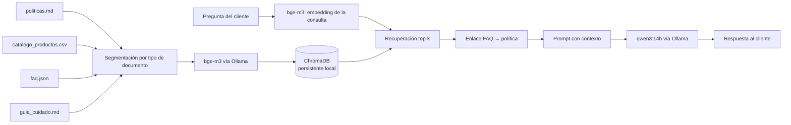

# Fase 1 — Selección de componentes clave del sistema RAG

**Taller Práctico #2 · IA Generativa · Caso EcoMarket**

**Decisión:** modelo de embeddings `bge-m3` (código abierto, ejecutado en local con Ollama) y base de datos vectorial ChromaDB en modo persistente local. Las alternativas evaluadas y los criterios de migración se documentan en las secciones 2.6 y 3.4.

---

## 1. Contexto y criterios de selección

EcoMarket atiende a clientes colombianos en español. La base de conocimiento inicial contiene cuatro documentos de naturaleza distinta (políticas de servicio, catálogo de productos, preguntas frecuentes y una guía de cuidado, ver Fase 2) y el asistente responde consultas que incluyen casos de seguridad (alergias, productos dañados) donde una recuperación incorrecta produce una respuesta incorrecta con consecuencias para el cliente.

Los criterios con los que se comparan las opciones son cuatro:

1. **Precisión de recuperación en español**, medida sobre preguntas propias de EcoMarket y con atención especial a las preguntas críticas.
2. **Costo**, tanto por consulta como de infraestructura.
3. **Privacidad de los datos del cliente.** Las consultas pueden contener datos personales sujetos a la Ley 1581 de 2012, y el procesamiento local evita transferirlos a terceros.
4. **Escalabilidad y facilidad de uso**, es decir, cuánto esfuerzo exige operar el componente hoy y cuánto exigiría si el volumen crece.

---

## 2. Modelo de embeddings

### 2.1 Método de evaluación

La elección se apoya en una medición y no en reputación. Se construyeron dos conjuntos de preguntas sobre el corpus de la Fase 2:

- **Conjunto oro** (`conjunto_oro.json`): 18 preguntas de clientes, 6 de ellas críticas (devolución de alimentos dañados, reacción alérgica, descuento por demora, advertencia de bebidas carbonatadas, alérgenos, excepción por defecto con envase abierto).
- **Conjunto de validación** (`conjunto_validacion.json`): 8 preguntas escritas antes de diseñar las intervenciones descritas en la Fase 2, para detectar ajuste excesivo al conjunto oro.

Cada pregunta declara los **textos** que deben aparecer en los fragmentos recuperados. Una pregunta cuenta como acierto en *k* si todos esos textos aparecen en la unión de los *k* primeros fragmentos (recall@k). La definición se basa en textos y no en identificadores de fragmento para que estrategias de segmentación distintas sean comparables entre sí.

Todos los modelos indexaron exactamente los mismos 56 fragmentos. Cada familia de modelos usa convenciones distintas para marcar consulta y documento (prefijos de texto o un campo de tipo de entrada), y el script las aplica según la ficha de cada modelo: `search_query:`/`search_document:` para nomic, una instrucción de tarea en la consulta para Qwen3, `input_type` para Voyage y ninguna para bge-m3.

### 2.2 Candidatos

La lista se armó con tres filtros: que el modelo se pueda ejecutar localmente con Ollama, que declare soporte multilingüe, y que quepa en un equipo con 24 GB de memoria. A esos se añadió `nomic-embed-text`, que es el modelo del Taller 1 y sirve de punto de comparación, y dos modelos propietarios de Voyage AI (el proveedor que recomienda la documentación de Anthropic, que no ofrece modelo propio de embeddings) para observar el extremo de pago. No se evaluaron modelos propietarios de OpenAI ni de otros proveedores; su precio se documenta en 2.5 sin medición de recall.

### 2.3 Resultados sobre el conjunto oro

| Modelo | Tipo | Dim. | R@1 | R@3 | R@5 | Críticas @3 | Fallan en k=3 | Peso |
|---|---|---|---|---|---|---|---|---|
| nomic-embed-text | abierto, local | 768 | 0.50 | 0.67 | 0.78 | 0.33 | 01 03 04 05 07 09 | 274 MB |
| snowflake-arctic-embed2 | abierto, local | 1024 | 0.72 | 0.83 | 0.89 | 0.50 | 01 04 07 | 1.2 GB |
| **bge-m3** | abierto, local | 1024 | 0.72 | 0.89 | 0.89 | 0.67 | 01 04 | 1.2 GB |
| voyage-4-lite | propietario, API | 1024 | 0.72 | 0.83 | 0.94 | 0.50 | 01 04 07 | API |
| voyage-4 | propietario, API | 1024 | 0.67 | 0.89 | 1.00 | 0.67 | 01 04 | API |
| qwen3-embedding:0.6b | abierto, local | 1024 | 0.61 | 0.83 | 0.94 | 0.50 | 04 07 09 | 639 MB |
| qwen3-embedding:4b | abierto, local | 2560 | 0.72 | 1.00 | 1.00 | 1.00 | — | 2.5 GB |
| qwen3-embedding:8b | abierto, local | 4096 | 0.72 | 1.00 | 1.00 | 1.00 | — | 4.7 GB |

Las tres filas de Qwen3 corresponden a una instrucción de consulta que describe la tarea en el contexto de EcoMarket. El control con la instrucción genérica del model card se presenta en 2.4.

### 2.4 Hallazgos

**Un modelo multilingüe mejora al baseline.** `nomic-embed-text` acierta 12 de 18 preguntas en k=3 y 2 de 6 críticas. `bge-m3`, `snowflake-arctic-embed2` y `voyage-4` llegan a 15–16 de 18. El resultado es consistente con la brecha de dominio observada en el Taller 1 con el clasificador por centroides, donde las consultas de prueba puntuaban, en mediana, por debajo del percentil 5 del propio conjunto de entrenamiento con `nomic-embed-text`. Son dos tareas distintas (clasificar y recuperar) y los dos resultados apuntan en la misma dirección, sin que uno demuestre al otro.

**Dos preguntas críticas fallan con todos los modelos sin instrucción de dominio.** oro-01 (producto perecedero llegado dañado) y oro-04 (producto de higiene abierto con envase partido) requieren recuperar juntas la restricción por categoría y la excepción por producto dañado. El recuperador prefiere los fragmentos de la FAQ, redactados como pregunta y por tanto muy parecidos a la consulta de un cliente, sobre los de políticas, redactados como norma. La FAQ omite la excepción por defecto, de modo que un contexto compuesto solo por FAQ llevaría al asistente a negar un derecho que el cliente tiene. Este patrón se repite con seis modelos de cinco proveedores, y por eso se trata en la Fase 2 como un problema de diseño del índice.

**La instrucción de consulta de Qwen3 explica el resultado de 18/18.** La instrucción con la que se midió `qwen3-embedding` nombra los tipos de documento de EcoMarket y fue redactada después de conocer los fallos del conjunto oro. Como control se repitió la medición con la instrucción genérica del model card, sin referencia al dominio:

| Modelo | Instrucción de dominio (R@3 / críticas) | Instrucción genérica (R@3 / críticas) |
|---|---|---|
| qwen3-embedding:0.6b | 0.83 / 0.50 | 0.83 / 0.50 |
| qwen3-embedding:4b | 1.00 / 1.00 | 0.89 / 0.67 |
| qwen3-embedding:8b | 1.00 / 1.00 | 0.83 / 0.50 |

Con la instrucción genérica, `qwen3-embedding:4b` vuelve a fallar oro-01 y oro-04, igual que `bge-m3`. Describir la tarea en la consulta es una palanca real de diseño y depende del texto de esa instrucción.

**Un modelo más grande no mejora este corpus.** Pasar de 4b a 8b no cambia el resultado con la instrucción de dominio y lo empeora con la genérica, a cambio de más latencia (99 ms frente a 67 ms por consulta), más memoria (4.7 GB frente a 2.5 GB) y vectores de 4096 dimensiones.

**La variante económica de Voyage pierde una pregunta crítica.** `voyage-4-lite` cuesta un tercio de `voyage-4` y falla además oro-07 (reacción alérgica). En un dominio con casos de seguridad, el ahorro se paga con precisión justo donde importa.

### 2.5 Costo

| Modelo | Costo por millón de tokens | Nota |
|---|---|---|
| bge-m3 (local) | sin costo de uso | hardware propio |
| voyage-4 | USD 0.06 | los primeros 200 M de tokens al mes son gratuitos |
| voyage-4-lite | USD 0.02 | mismo tramo gratuito |
| OpenAI text-embedding-3-small | USD 0.02 (lote: 0.01) | no medido |
| OpenAI text-embedding-3-large | USD 0.13 (lote: 0.065) | no medido |

*Fuentes: documentación de precios de Voyage AI y tabla de precios de OpenAI, consultadas el 30 de septiembre de 2026.*

Indexar el corpus completo y evaluar las 18 preguntas consumió 6 561 tokens, equivalentes a USD 0.0004 con `voyage-4` sin contar el tramo gratuito. En operación, cada consulta aporta unas decenas de tokens, de modo que un millón de consultas al mes (alrededor de 30 millones de tokens) costaría cerca de USD 1.80 con `voyage-4` y quedaría dentro del tramo gratuito. A este volumen el costo no decide entre abierto y propietario.

### 2.6 Decisión

Se adopta **`bge-m3`**, en ejecución local mediante Ollama. Los elementos que sustentan la decisión son:

- Acierta 16 de 18 preguntas en k=3, igual que el mejor modelo propietario evaluado, con 15.6 ms por consulta y 1.2 GB de memoria.
- Con el enlace FAQ→política descrito en la Fase 2, `bge-m3` alcanza 18/18 en el conjunto oro (críticas 6/6) y 0.88 de recall@3 en el conjunto de validación (críticas 4/5). `qwen3-embedding:4b` con instrucción genérica produce exactamente las mismas cifras, de modo que el rediseño del índice iguala el rendimiento de un modelo más pesado.
- No envía consultas de clientes a un tercero, coherente con el criterio de privacidad de la sección 1.
- Su ficha declara soporte multilingüe y una ventana de contexto de 8 192 tokens, que deja margen para fragmentos más largos si la estrategia de segmentación lo requiere.

**Alternativas documentadas.** `qwen3-embedding:4b` con instrucción de dominio es la ruta de mejora si el corpus crece: rankea mejor el primer resultado (R@1 de 0.62 frente a 0.38 en validación con la segmentación final) a cambio de 2.5 GB de memoria, unos 50 ms adicionales por consulta y vectores de 2560 dimensiones. `voyage-4` es la opción gestionada para una operación que no quiera administrar infraestructura de embeddings.

### 2.7 Límites de la evidencia

- Los conjuntos contienen 18 y 8 preguntas sobre un corpus sintético elaborado para el taller; una pregunta pesa 5.6 puntos porcentuales en el primero y 12.5 en el segundo. Las cifras son evidencia de esta prueba y no una estimación general del rendimiento de los modelos.
- La instrucción de dominio de Qwen3 y los prefijos de cada familia provienen de las fichas de los modelos y no se verificaron de forma independiente.
- La latencia de los modelos de API se midió como el promedio de un lote de consultas y no es comparable con la de los modelos locales, que se midió consulta por consulta. La latencia de extremo a extremo se evalúa en la Fase 3.
- La pregunta val-02 (síntoma descrito con vocabulario distinto al de la norma) no se recupera con ninguno de los modelos ni estrategias probados. Se documenta como limitación en la Fase 2.

---

## 3. Base de datos vectorial

### 3.1 Opciones consideradas

El enunciado menciona Pinecone, ChromaDB y Weaviate. Se añade como referencia Oracle AI Vector Search, que incorpora un tipo de dato `VECTOR` e índices vectoriales aproximados dentro de la base de datos relacional.

| | ChromaDB | Pinecone | Weaviate | Oracle AI Vector Search |
|---|---|---|---|---|
| Naturaleza | código abierto | servicio propietario gestionado (serverless) | código abierto con servicio gestionado propio | función de la base de datos relacional |
| Despliegue | en memoria, persistente en disco local, cliente-servidor HTTP o Chroma Cloud | solo nube gestionada | autoalojado o Weaviate Cloud | dentro de la base de datos |
| Costo de entrada | sin costo en local; Chroma Cloud Starter gratuito con USD 5 de crédito | plan Starter gratuito: 2 GB, 2 M de write units y 1 M de read units al mes, 5 índices, 1 proyecto, región us-east-1 | plan gratuito: 100 000 objetos, 1 GB de memoria, 10 GB de disco | requiere una versión con soporte del tipo `VECTOR` (`COMPATIBLE` ≥ 23.4.0) |
| Costo al crecer | Chroma Cloud por uso (USD 2.50/GiB escrito, 0.33/GiB almacenado al mes) | Builder USD 20/mes; Standard desde USD 50/mes | Flex desde USD 45/mes | según licenciamiento de la base |
| Operación | una línea de instalación y cero servicios | cuenta, clave de API y elección de región | contenedor propio o cuenta en la nube, más definición de colecciones | administración de base de datos |
| Datos del cliente | permanecen en el equipo | salen a un tercero | permanecen si se autoaloja | permanecen en la base |

*Fuentes: páginas de precios de Pinecone, Weaviate y Chroma y documentación de Oracle AI Vector Search, consultadas el 30 de septiembre de 2026.*

### 3.2 Dimensionamiento

Con vectores de 1 024 dimensiones en float32, cada fragmento ocupa 4 KB. El corpus actual (56 fragmentos) pesa unos 224 KB. Un escenario de 100 000 fragmentos, que correspondería a un catálogo de miles de productos con su historial de políticas y preguntas, ocuparía alrededor de 400 MB de vectores sin contar metadatos ni índice. Ese volumen cabe con holgura en las tres opciones de código abierto o gratuitas de la tabla.

### 3.3 Ventajas y desventajas para EcoMarket

**ChromaDB** ofrece la menor fricción: se instala con `pip`, persiste en un directorio local, se integra con LangChain mediante un paquete propio y mantiene los datos dentro del equipo. Sus limitaciones aparecen al crecer: el modo embebido corre en un solo nodo y no ofrece por sí mismo alta disponibilidad.

**Pinecone** elimina la operación de infraestructura y escala de forma automática, con un plan gratuito generoso para un prototipo. Exige enviar vectores y metadatos a un proveedor externo, fija la región del plan gratuito en us-east-1 y su costo pasa de cero a un mínimo mensual al salir del plan Starter.

**Weaviate** combina una base de código abierto con una nube gestionada y soporta búsqueda híbrida. Requiere definir colecciones y operar un servicio adicional, lo que agrega complejidad que un corpus de 56 fragmentos no necesita.

**Oracle AI Vector Search** permite consultar vectores junto a datos relacionales con SQL y evita mover los datos a otro sistema. Su uso exige una versión de base de datos con soporte del tipo `VECTOR`, por lo que solo aplica si la empresa ya opera esa plataforma.

### 3.4 Decisión

Se adopta **ChromaDB en modo persistente local** (`chromadb.PersistentClient`). Con un corpus de 56 fragmentos y un crecimiento esperado de órdenes de magnitud menores a las capacidades de cualquier opción, los factores que más pesan son la privacidad (los datos no salen del equipo), el costo nulo y la facilidad de uso.

**Criterios de migración.** La solución debe pasar a un servicio cliente-servidor o a una opción gestionada cuando se cumpla alguno de estos: varios servicios necesitan escribir o leer de forma concurrente, el volumen presiona la memoria de un solo nodo, o se requiere un acuerdo de disponibilidad. Como LangChain expone una interfaz común para los almacenes de vectores, el cambio consiste en reemplazar la clase del vector store y su configuración, sin tocar la lógica de recuperación ni el prompt.

---

## 4. Arquitectura resultante



La segmentación por tipo de documento y el enlace FAQ → política se describen en la Fase 2. El modelo generador (`qwen3:14b`) es el mismo del Taller 1, y su integración con el clasificador de solicitudes se trata en la Fase 3.

---

## 5. Reproducibilidad

Los resultados de esta fase se regeneran con los scripts del repositorio, desde un entorno con Python 3.12 y Ollama en ejecución:

```bash
python -m venv .venv && source .venv/bin/activate
pip install numpy requests
ollama pull nomic-embed-text && ollama pull bge-m3 && ollama pull snowflake-arctic-embed2
ollama pull qwen3-embedding:0.6b && ollama pull qwen3-embedding:4b && ollama pull qwen3-embedding:8b
python medir_embeddings.py --modelos nomic-embed-text bge-m3 snowflake-arctic-embed2 \
       qwen3-embedding:0.6b qwen3-embedding:4b qwen3-embedding:8b
python medir_embeddings.py --modelos qwen3-embedding:0.6b qwen3-embedding:4b qwen3-embedding:8b --instruccion-generica
```

Los modelos de Voyage requieren una clave de API exportada como variable de entorno (`VOYAGE_API_KEY`) y se añaden con `--modelos voyage:voyage-4 voyage:voyage-4-lite`. El detalle por pregunta de cada modelo queda en `resultados_embeddings.json`.
